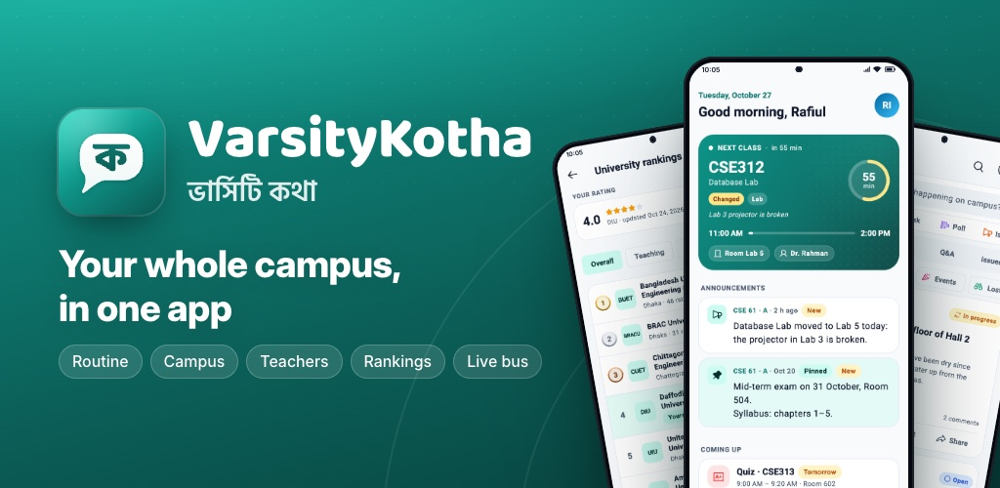
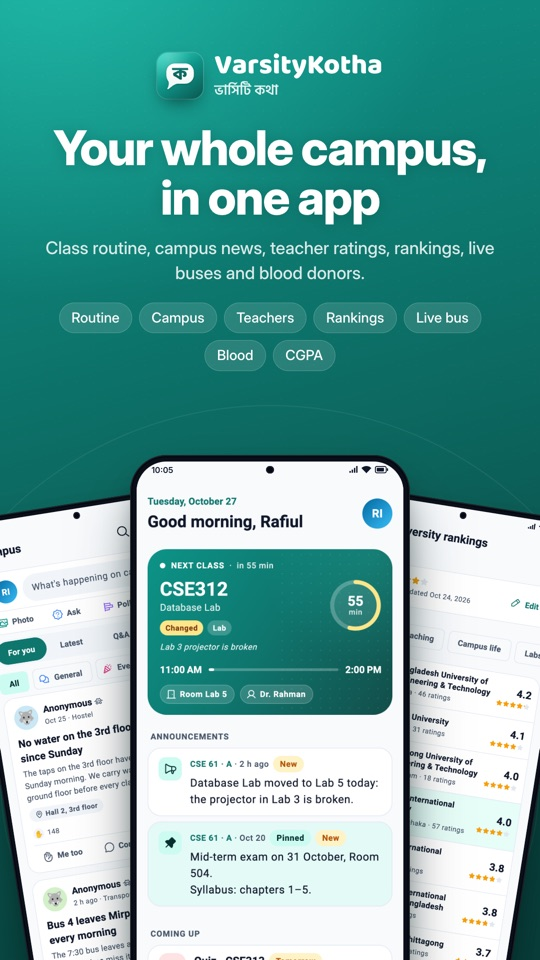
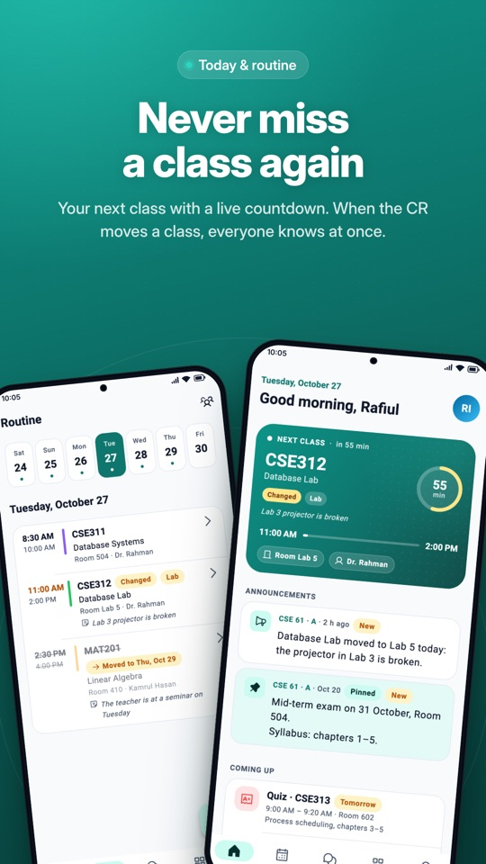
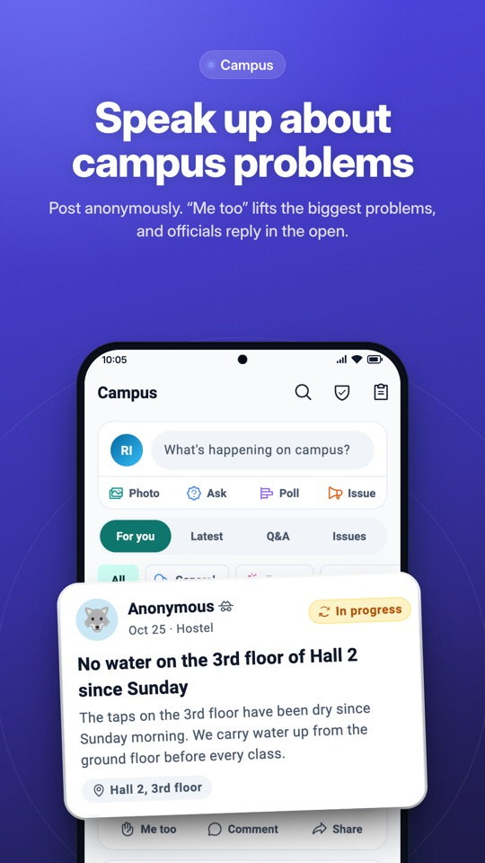
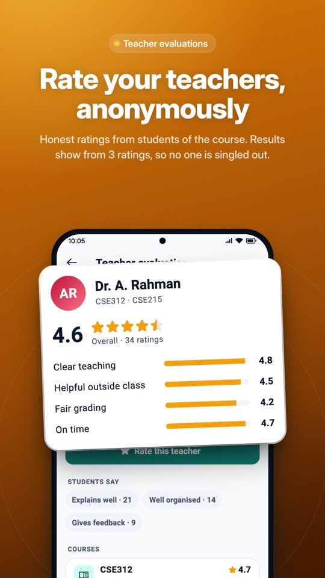
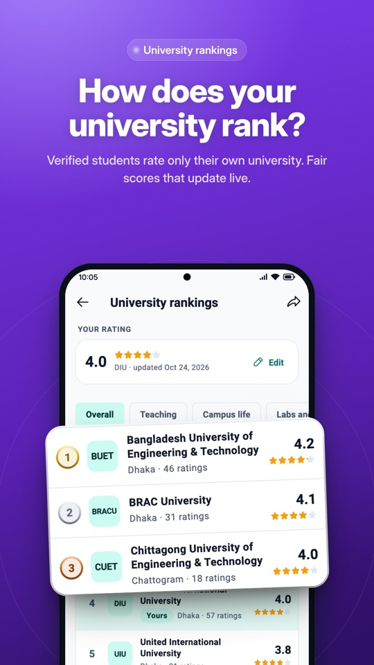
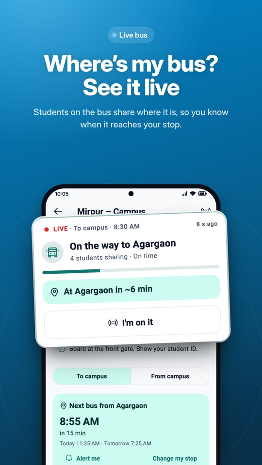
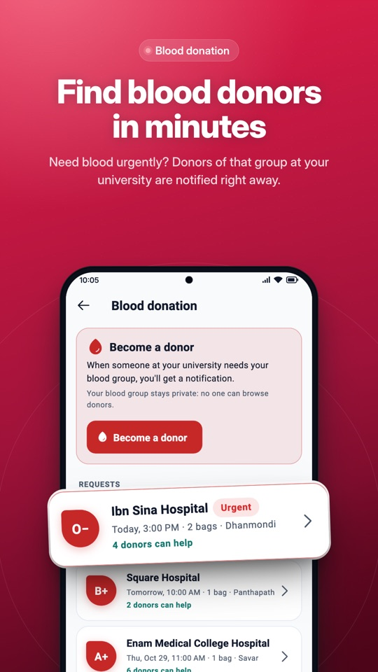
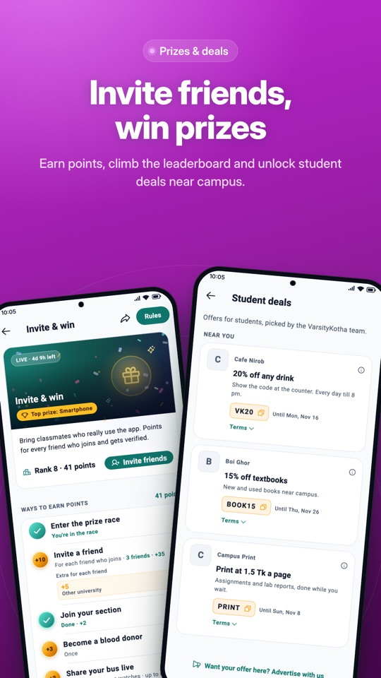
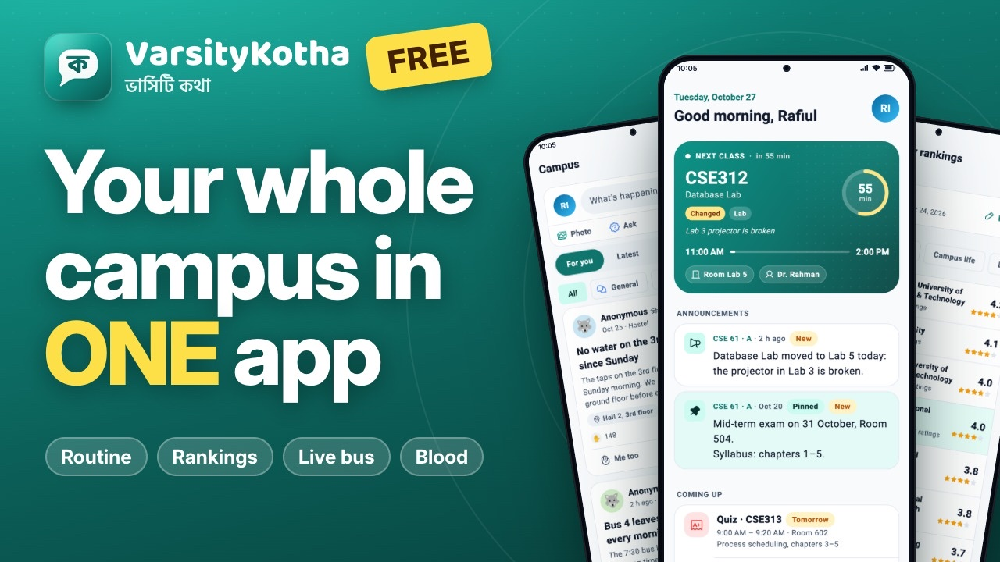

# VarsityKotha · ভার্সিটি কথা

**Your whole campus, in one app.**
The free everyday app for university students in Bangladesh: class routine,
campus voice, teacher ratings, university rankings, live buses and blood
donors, in English and Bangla.

[**Get it on Google Play**](https://play.google.com/store/apps/details?id=com.silifton.varsitykotha) · [Website](https://varsitykotha.com) · [Watch the video](https://youtu.be/HhESnoUP5W4) · [বাংলায় দেখো](https://youtu.be/Q5LzEDVuJGk)

## A look inside

<table>
  <tr>
    <td></td>
    <td></td>
    <td></td>
    <td></td>
  </tr>
  <tr>
    <td></td>
    <td></td>
    <td></td>
    <td></td>
  </tr>
</table>

  
   
  VarsityKotha in 45 seconds · <a href="https://youtu.be/Q5LzEDVuJGk">বাংলায় দেখো</a>

## What students get

**Never miss a class**
- Today shows your next class, room and teacher, with a live countdown. Two
  classes at once? Swipe between them.
- One routine for the whole section: the CR sets it up once and everyone
  gets it.
- Cancelled, rescheduled or moved to a new room: a notification reaches
  everyone at once.
- Class tests, assignments and exams, with a reminder the evening before.
- Works offline, with a home-screen widget.

**Your campus, your voice**
- A campus feed for news, questions, polls, events and lost & found.
- Raise problems about classes, halls, transport, food or Wi-Fi without your
  name. "Me too" lifts the problems that affect the most students.
- University officials reply in the open and update the status until it's
  solved.

**Teachers and universities**
- Rate the teachers of the courses you take, anonymously. Results show from
  3 ratings, so nobody can tell who rated.
- University rankings: verified students rate their own university on
  teaching, campus life, facilities, safety, transport, food and careers.

**Getting around and helping out**
- University bus routes with every stop, the next bus from yours, and live
  position when riders share it.
- Blood donation: donors of the right group at your university are notified
  in minutes. Your blood group stays private.

**And more**
- CGPA calculator on the UGC 4.00 scale, with a target planner
  ([try it on the web](https://varsitykotha.com/cgpa-calculator)).
- Prize campaigns, badges and student deals near campus.
- Join with your university email or Google; everything in English and
  Bangla, light and dark.

## Private by design

- Campus posts and teacher ratings are anonymous: no student, teacher or
  official can see who wrote or rated.
- No third-party ads or tracking, and we never sell data. Sponsored offers are
  picked by our team, clearly labelled, and sponsors only ever see totals.
- Delete your account from the app at any time.

Read the [privacy policy](https://varsitykotha.com/privacy).

## For universities, clubs and brands

- **CRs and clubs:** set up your section's routine or your university's bus
  routes in the app.
- **Brands and shops:** reach students with deals and sponsored cards that
  respect their privacy. [Advertise with us](https://varsitykotha.com/advertise).

Questions or ideas: [hello@silifton.com](mailto:hello@silifton.com).

## Built with

- **App:** Flutter (Android and iOS), in English and Bangla
- **Website:** Next.js
- **API:** Go and PostgreSQL

## License

Proprietary. Copyright © 2026 Silifton. All rights reserved. This
repository shows what VarsityKotha is; its source code is private. Nothing
here may be copied, republished, modified or reused, or used to build
anything; see [LICENSE](LICENSE). Permission requests: hello@silifton.com.

---

Made in Bangladesh by <a href="https://www.silifton.com">Silifton</a> · © Silifton. All rights reserved.

